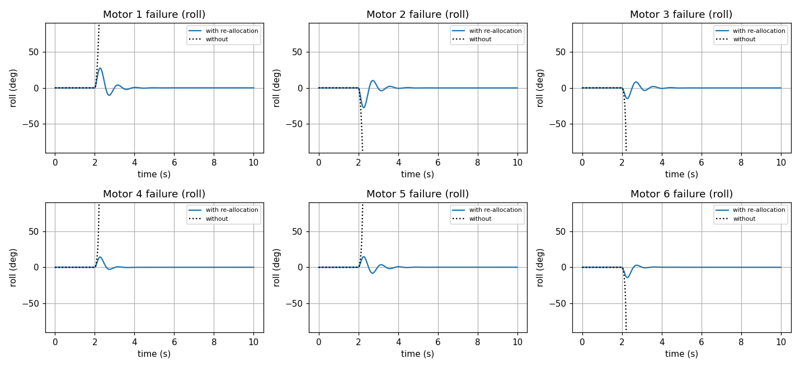
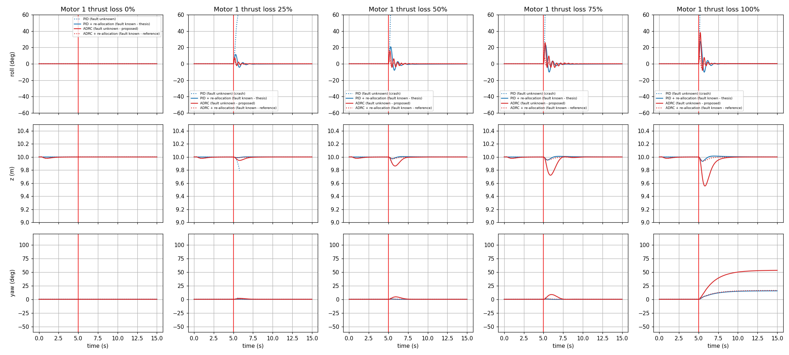
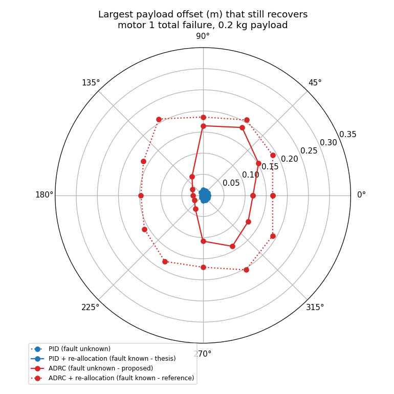

# Report: Hexacopter Fault Tolerant Control: Control Re-allocation and ADRC

**Simulation videos (ROS 2 + RViz):** [Google Drive folder](https://drive.google.com/drive/folders/1Yvr0sd7mPDu3fAa-QyxSlOduzrMHX4zT?usp=sharing)

## 1. Objective

Keep a hexacopter hovering after one motor fails, using two approaches:

1. **Control re-allocation** (thesis method): the failed motor is known, and the control effort is redistributed over the remaining five motors.
2. **ADRC** (after Prachetas P et al., ETAAV 2025): the controller is never told about the fault. It treats the fault, and an unknown off-centre payload, as one total disturbance that it estimates and cancels.

## 2. Model and baseline controller

| Item | Value |
|---|---|
| Mass, arm length | 0.95 kg, 0.33 m |
| Inertia (Jxx, Jyy, Jzz) | 6.89e-3, 6.89e-3, 3.44e-2 kg·m² |
| Motors | kf = 3.13e-4, km = 7.5e-6, limit 110 rad/s, time constant 0.1 s, hover speed 70.4 rad/s |
| Control loop | 100 Hz |
| Scenario | Hover at 10 m, then one motor fails |

- **Controller:** a PX4-style PID cascade. Attitude uses angle P → rate PI; altitude uses position P → climb-rate PID. It outputs the desired moments M = [τφ, τθ, τψ, T].
- **Allocation:** M = G·ω², solved with a weighted pseudo-inverse, Ws = diag(0.3, 0.3, 0.15, 0.25). After a fault, the failed motor's column of G is set to zero. If a motor would saturate, a bounded least-squares solve is used instead.
- **Controllability:** the controllability matrix has rank 4 for every single-motor failure, so the vehicle stays controllable. Every failure leaves yaw torque in **one direction only**, and roll or pitch also lose one direction.

## 3. Results: control re-allocation (fault known)

| Failed motor | Without re-allocation | With re-allocation: peak roll / pitch | Min altitude | Settle time | Final yaw |
|---|---|---|---|---|---|
| M1, M2 | flips after 0.22 s | 27° / 3° | 9.93 m | 1.6 s | ±15° |
| M3 – M6 | flips after 0.22 s | 15° / 24° | 9.93 m | 1.3 – 1.7 s | ±15° |

- With the normal mixer, the vehicle flips 0.22 s after any motor failure. With re-allocation, every case returns to level hover.
- The allocator also turns off the **opposite motor** (for example, M2 when M1 fails). The remaining four run at 86 rad/s, which leaves about 22% headroom below the limit.
- **Yaw is given up.** Only one direction of yaw torque is left, so the heading settles about 15° off. Roll, pitch and altitude are kept, which is the intended trade-off.
- Peak roll for M1 matches the thesis (27.4° here, about 28° there).

## 4. ADRC: fault treated as a disturbance

### Implementation

Each axis (roll, pitch, yaw, altitude) has its own loop:

- **Tracking differentiator** (Han's `fhan`): turns the reference into a smooth profile.
- **Linear extended state observer (LESO):** estimates the angle z₁, the rate z₂ and the total disturbance z₃. Its gains are 3ω_o, 3ω_o² and ω_o³.
- **Control law:** u = (k_p(v₁ − z₁) + k_d(v₂ − z₂) − z₃) / b₀, with k_p = ω_c², k_d = 2ω_c, and b₀ = 1/J (1/m for altitude).

Choices specific to the hexacopter:

- **Fault-blind:** the moments always go through the **healthy mixer**. The controller gets no fault information.
- **Gains:** roll and pitch use ω_c = 14 and ω_o = 50 rad/s; yaw and altitude use 2 and 10 rad/s. Lower attitude gains react too slowly, and the vehicle tips over before the observer catches the fault.
- **Motor lag:** the LESO is fed the commanded torque passed through the known 0.1 s motor model. Without this, the observer treats the motor lag as a disturbance and the loop goes unstable.
- **Payload:** a 0.2 kg point mass (about 20% of the vehicle mass) at radius r and direction θ in the rotor plane. It is picked up over 0–2 s, and then motor 1 fails at t = 5 s. Neither controller is told about the payload.

Four setups are compared: PID with the fault unknown, PID + re-allocation with the fault known, **ADRC with the fault unknown** (the proposed method), and ADRC + re-allocation as a reference.

Code: [python/hexa_adrc.py](python/hexa_adrc.py). Results: [python/results_adrc/](python/results_adrc/).

### Key result 1: ADRC survives the fault without knowing about it

Peak tilt after a motor 1 fault, by thrust loss:

| Thrust loss of M1 | PID, fault unknown | PID + re-alloc, fault known | **ADRC, fault unknown** |
|---|---|---|---|
| 25% | crash | 11.4° | **7.2°** |
| 50% | crash | 20.8° | **15.8°** |
| 75% | crash | 23.1° | **25.9°** |
| 100% | crash | 27.4° | **38.3°** |

- Fault-blind PID crashes even at 25% thrust loss. **Fault-blind ADRC recovers at every level.**
- Up to 50% loss, it even does better than re-allocation, which knows the fault.
- At total loss, ADRC dips 44 cm (re-allocation: 7 cm) and settles in 2.5 s (re-allocation: 1.6 s).
- ADRC also ends up turning off M2, the configuration re-allocation chooses on purpose. ADRC gets there by itself, through the observer.

### Key result 2: payload location matters

Largest payload offset (0.2 kg) that still recovers after motor 1 fails:

| Payload side | PID, fault unknown | PID + re-alloc, fault known | **ADRC, fault unknown** | ADRC + re-alloc |
|---|---|---|---|---|
| Away from the failed motor (M2, M3, M6) | 0 | ≤ 1.3 cm | **11–19 cm** | 15–21 cm |
| Toward the failed motor (M1, M4, M5) | 0 | ≤ 0.8 cm | **2–5 cm** | 15–21 cm |

- **PID cannot carry an unknown off-centre payload at all.** Its integrator is clamped, so the vehicle already hangs at about 38° of tilt before the fault.
- **ADRC holds the payload level**, with under 1° of tilt. At 10 cm it survives the fault in 8 of the 12 directions.
- **The weak spot is a payload on the failed motor's side.** There the healthy mixer keeps sending effort to the dead motor, and the motors on the opposite side saturate. This is the one case where knowing the fault matters: ADRC + re-allocation handles 15–21 cm in every direction.

### Trade-off: sensor noise

With 1° of attitude noise, ADRC still recovers, but its motor commands jitter about **7× more** than PID + re-allocation (1.38 vs 0.19 rad/s). This is the cost of its high observer bandwidth.

## 5. ROS 2 implementation

- **Nodes:** `plant_node` (dynamics, fault, payload, RViz scene) and `ftc_node` (controller and allocation) run in lockstep over `/state` and `/motor_cmd`. Both import the same Python modules as the offline study.
- **Launch arguments:**
  - `controller:=pid|adrc`
  - `use_ftc:=true|false` (re-allocation on or off)
  - `fault_motor`, `fault_eta`
  - `payload_mass`, `payload_r`, `payload_angle`
- **Validation:** the ROS runs reproduce the Python results, with the same crash outcomes, peak angles and minimum altitudes, and roll traces within 0.03°.

Results: [ros2_ws/results_ros/](ros2_ws/results_ros/) (re-allocation) and [ros2_ws/results_adrc_ros/](ros2_ws/results_adrc_ros/) (ADRC).

## 6. Conclusions

- With the fault known, re-allocation recovers from any single motor failure in under 1.7 s, with tilt under 28° and altitude loss under 7 cm. The heading drifts about 15°.
- **ADRC removes the need to know which motor failed.** It recovers from 25–100% thrust loss of a motor, and it carries an unknown off-centre payload, which PID cannot.
- Fault-blind ADRC fails when the payload sits on the failed motor's side, beyond 2–5 cm. Combining ADRC with fault knowledge covers every direction.
- **Limitations:**
  - Re-allocation assumes the fault is detected instantly.
  - ADRC's high gains make it sensitive to sensor noise.
  - The payload is a point mass in the rotor plane.
  - There is no horizontal position control.
