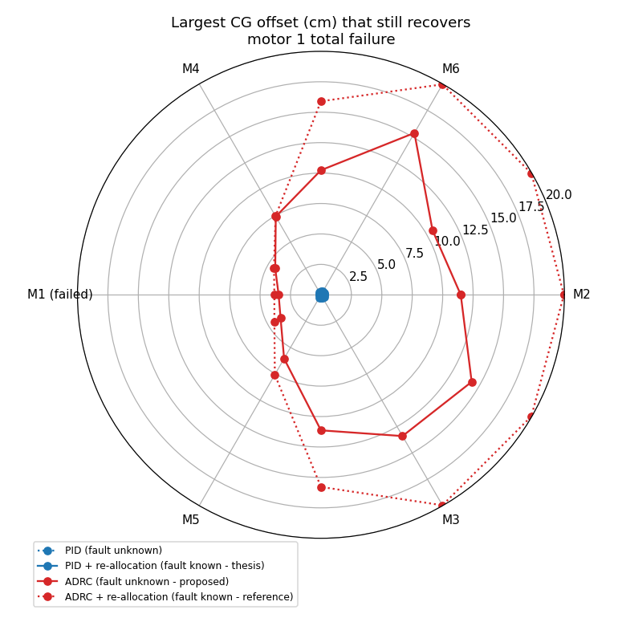
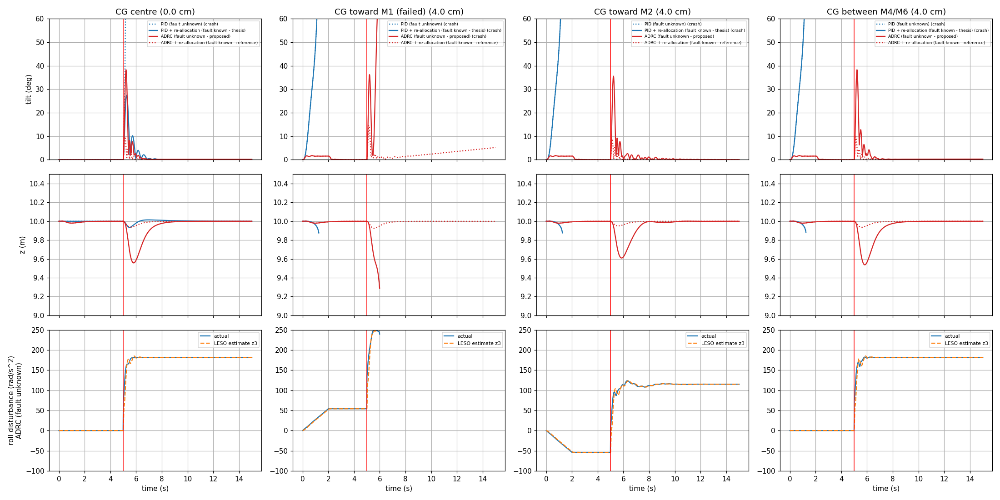
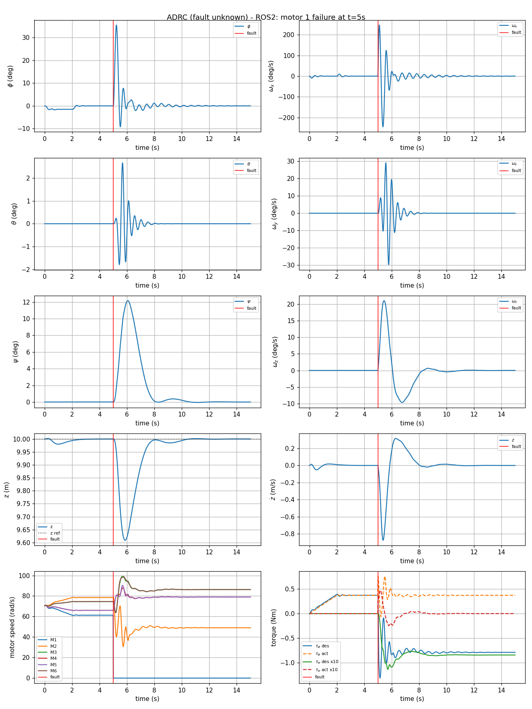

# Report: Hexacopter Fault Tolerant Control: Control Re-allocation and ADRC

**Simulation videos (ROS 2 + RViz):** [Google Drive folder](https://drive.google.com/drive/folders/1Yvr0sd7mPDu3fAa-QyxSlOduzrMHX4zT?usp=sharing)

## 1. Objective

Keep a hexacopter hovering after one motor fails, using two approaches:

1. **Control re-allocation** (thesis method): the failed motor is known, and the control effort is redistributed over the remaining five motors.
2. **ADRC** (after Prachetas P et al., ETAAV 2025): the controller is never told about the fault. It treats the fault, and an unknown centre-of-gravity (CG) offset, as one total disturbance that it estimates and cancels.

## 2. Model and baseline controller

| Item | Value |
|---|---|
| Mass, arm length | 0.95 kg, 0.33 m |
| Inertia (Jxx, Jyy, Jzz) | 6.89e-3, 6.89e-3, 3.44e-2 kg·m² |
| Motors | kf = 3.13e-4, km = 7.5e-6, limit 110 rad/s, time constant 0.1 s, hover speed 70.4 rad/s |
| Control loop | 100 Hz |
| Scenario | Hover at 10 m, then one motor fails |

- **Controller:** a PX4-style PID cascade. Attitude uses angle P → rate PI; altitude uses position P → climb-rate PID. It outputs the desired moments M = [τφ, τθ, τψ, T].
- **Allocation:** M = G·ω², solved with a weighted pseudo-inverse, Ws = diag(0.3, 0.3, 0.15, 0.25). After a fault, the failed motor's column of G is set to zero. If a motor would saturate, a bounded least-squares solve is used instead.
- **Controllability:** the controllability matrix has rank 4 for every single-motor failure, so the vehicle stays controllable. Every failure leaves yaw torque in **one direction only**, and roll or pitch also lose one direction.

## 3. Results: control re-allocation (fault known)

| Failed motor | Without re-allocation | With re-allocation: peak roll / pitch | Min altitude | Settle time | Final yaw |
|---|---|---|---|---|---|
| M1, M2 | flips after 0.22 s | 27° / 3° | 9.93 m | 1.6 s | ±15° |
| M3 – M6 | flips after 0.22 s | 15° / 24° | 9.93 m | 1.3 – 1.7 s | ±15° |

- With the normal mixer, the vehicle flips 0.22 s after any motor failure. With re-allocation, every case returns to level hover.
- The allocator also turns off the **opposite motor** (for example, M2 when M1 fails). The remaining four run at 86 rad/s, which leaves about 22% headroom below the limit.
- **Yaw is given up.** Only one direction of yaw torque is left, so the heading settles about 15° off. Roll, pitch and altitude are kept, which is the intended trade-off.
- Peak roll for M1 matches the thesis (27.4° here, about 28° there).

Motor 1 failure in detail: angles, rates, altitude, motor speeds and torques. The dotted line is the same failure without re-allocation.

## 4. ADRC: fault treated as a disturbance

### Implementation

Each axis (roll, pitch, yaw, altitude) has its own loop:

- **Tracking differentiator** (Han's `fhan`): turns the reference into a smooth profile.
- **Linear extended state observer (LESO):** estimates the angle z₁, the rate z₂ and the total disturbance z₃. Its gains are 3ω_o, 3ω_o² and ω_o³.
- **Control law:** u = (k_p(v₁ − z₁) + k_d(v₂ − z₂) − z₃) / b₀, with k_p = ω_c², k_d = 2ω_c, and b₀ = 1/J (1/m for altitude).

Choices specific to the hexacopter:

- **Fault-blind:** the moments always go through the **healthy mixer**. The controller gets no fault information. This is stricter than the paper, which switches gains and set-points once a severe fault happens. Here nothing is ever switched.
- **Gains:** roll and pitch use ω_c = 14 and ω_o = 50 rad/s; yaw and altitude use 2 and 10 rad/s. Lower attitude gains react too slowly, and the vehicle tips over before the observer catches the fault.
- **Motor lag:** the LESO is fed the commanded torque passed through the known 0.1 s motor model. Without this, the observer treats the motor lag as a disturbance and the loop goes unstable.
- **CG offset:** the CG is moved a distance r from the centre of the motors, in direction θ within the rotor plane. Mass and inertia stay the same, so the thrust now acts with a lever arm r about the CG (τ = −r × T). The offset is ramped in over 0–2 s so the vehicle starts from a trimmed hover, and then motor 1 fails at t = 5 s. Neither controller is told about the CG.

Four setups are compared: PID with the fault unknown, PID + re-allocation with the fault known, **ADRC with the fault unknown** (the proposed method), and ADRC + re-allocation as a reference.

Code: [python/hexa_adrc.py](python/hexa_adrc.py). Results: [python/results_adrc/](python/results_adrc/).

### Key result 1: ADRC survives the fault without knowing about it

Peak tilt after a motor 1 fault, by thrust loss:

| Thrust loss of M1 | PID, fault unknown | PID + re-alloc, fault known | **ADRC, fault unknown** |
|---|---|---|---|
| 25% | crash | 11.4° | **7.2°** |
| 50% | crash | 20.8° | **15.8°** |
| 75% | crash | 23.1° | **25.9°** |
| 100% | crash | 27.4° | **38.3°** |

- Fault-blind PID crashes even at 25% thrust loss. **Fault-blind ADRC recovers at every level.**
- Up to 50% loss, it even does better than re-allocation, which knows the fault.
- At total loss, ADRC dips 44 cm (re-allocation: 7 cm) and settles in 2.5 s (re-allocation: 1.6 s).
- ADRC also ends up turning off M2, the configuration re-allocation chooses on purpose. ADRC gets there by itself, through the observer.

### Key result 2: CG location matters

Largest CG offset that still recovers after motor 1 fails:

| CG direction | PID, fault unknown | PID + re-alloc, fault known | **ADRC, fault unknown** | ADRC + re-alloc |
|---|---|---|---|---|
| Away from the failed motor (M2, M3, M6 side) | 0 | ≤ 0.3 cm | **10–15 cm** | ≥ 15.8 cm |
| Toward M4 or M5 (next to the failed motor) | 0 | ≤ 0.3 cm | **6.1–7.4 cm** | 7.5–7.6 cm |
| Toward the failed motor (M1) | 0 | ≤ 0.2 cm | **3.5–4.3 cm** | 3.8–4.5 cm |

The search stops at 20 cm. Fault-blind PID scores 0 because it crashes from the motor failure alone, even with the CG centred.

- **PID cannot handle an unknown CG offset.** Its rate integrator is clamped at about 0.007 N·m, so an offset of more than 1–3 mm tips it over before the fault even happens.
- **ADRC holds a CG offset level**: with the CG 4 cm off, the tilt before the fault stays under 2°, and it survives the motor failure in 10 of the 12 directions.
- **The weak spot is a CG on the failed motor's side.** Here knowing the fault barely helps (3.5 cm fault-blind vs 3.8 cm with re-allocation). This is a physical limit: the remaining motors on the far side saturate.

This plot uses a 4 cm CG offset. The bottom row shows how ADRC works. The LESO estimate z₃ follows the actual roll disturbance: first the CG offset ramping in (about ±55 rad/s²), then the jump when motor 1 fails (about 115–180 rad/s² in the cases that recover). It catches the jump within about 0.2 s, without being told what changed. With the CG toward M1, the disturbance is still estimated correctly, but the motors saturate and the vehicle crashes.

### Trade-off: sensor noise

With 1° of attitude noise, ADRC still recovers, but its motor commands jitter about **7× more** than PID + re-allocation (1.38 vs 0.19 rad/s). This is the cost of its high observer bandwidth.

## 5. ROS 2 implementation

- **Nodes:** `plant_node` (dynamics, fault, CG offset, RViz scene) and `ftc_node` (controller and allocation) run in lockstep over `/state` and `/motor_cmd`. Both import the same Python modules as the offline study.
- **Launch arguments:**
  - `controller:=pid|adrc`
  - `use_ftc:=true|false` (re-allocation on or off)
  - `fault_motor`, `fault_eta`
  - `cg_cm`, `cg_angle`
- **Validation:** the ROS runs reproduce the Python results, with the same crash outcomes and attitude traces within 0.001°.

Results: [ros2_ws/results_ros/](ros2_ws/results_ros/) (re-allocation) and [ros2_ws/results_adrc_ros/](ros2_ws/results_adrc_ros/) (ADRC).

ROS 2 run of fault-blind ADRC with the CG 4 cm toward M2, and motor 1 failing at t = 5 s:

## 6. Conclusions

- With the fault known, re-allocation recovers from any single motor failure in under 1.7 s, with tilt under 28° and altitude loss under 7 cm. The heading drifts about 15°.
- **ADRC removes the need to know which motor failed.** It recovers from 25–100% thrust loss of a motor, and it handles an unknown CG offset, which PID cannot.
- With the fault unknown, ADRC tolerates a CG offset of 10–15 cm away from the failed motor, but only 3.5–4.3 cm toward it. Toward the failed motor, knowing the fault barely helps: the limit there is the thrust of the remaining motors.
- **Limitations:**
  - Re-allocation assumes the fault is detected instantly.
  - ADRC's high gains make it sensitive to sensor noise.
