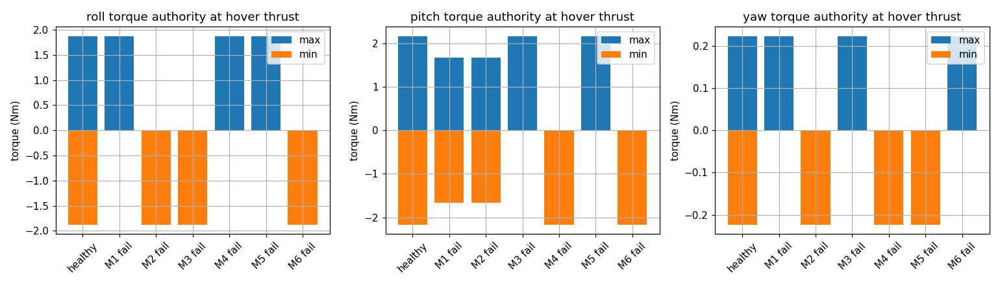
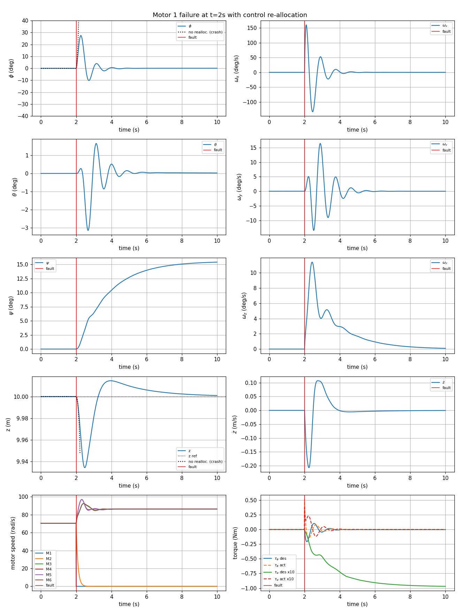
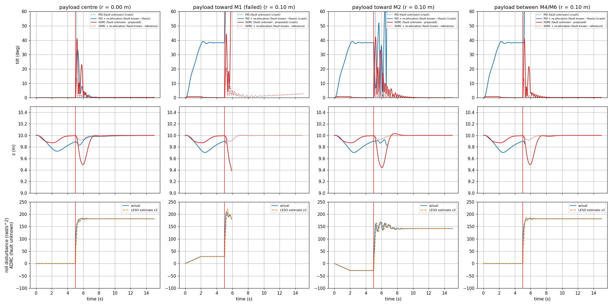

# Report: Hexacopter Fault Tolerant Control: Control Re-allocation and ADRC

**Simulation video (all cases, ROS 2 + RViz):** [Google Drive](https://drive.google.com/file/d/1snuhvErvYkib8klGl688AJ4HS31CERCj/view?usp=sharing)

## 1. Objective

Keep a hexacopter in stable hover after one motor fails completely, by redistributing the control effort over the remaining five motors (control re-allocation). The fault is assumed to be known as soon as it happens (no fault detection and isolation).

Section 6 then drops that assumption. Following the ADRC approach for quadcopters (Prachetas P et al., ETAAV 2025), an Active Disturbance Rejection Controller is never told about the fault and treats it as one more disturbance. It is tested with partial and total motor loss, and with an unknown off-centre payload in every direction.

## 2. Setup

| Item | Value |
|---|---|
| Mass, arm length | 0.95 kg, 0.33 m |
| Inertia (Jxx, Jyy, Jzz) | 6.89e-3, 6.89e-3, 3.44e-2 kg·m² |
| Thrust / drag coefficient (kf, km) | 3.13e-4, 7.5e-6 |
| Motor limit, time constant | 110 rad/s, 0.10 s |
| Hover motor speed | 70.4 rad/s |
| Control loop | 100 Hz (Ts = 0.01 s) |
| Scenario | Hover at 10 m, total motor failure at t = 2 s, 10 s run |

**Controller:** a PX4-style cascade. Attitude uses angle P → rate PI, and altitude uses position P → climb-rate PID. The controller outputs the desired moments M = [τφ, τθ, τψ, T].

**Allocation:** motor speeds come from M = G·ω².
- Healthy: weighted pseudo-inverse, ω² = (Ws·G)⁺·Ws·M, with Ws = diag(0.3, 0.3, 0.15, 0.25).
- After a fault: the failed motor's column of G is set to zero (Gᵢ), and the same weighted pseudo-inverse is used with Gᵢ.
- If any motor would saturate, a bounded least-squares solve (0 ≤ ω² ≤ ω_max²) is used instead.

**Cases:** no fault, no fault + disturbance (a torque gust during 3–4 s and a −2 N vertical push during 6–7 s), and failure of each motor 1–6. Every fault case is run with and without re-allocation.

## 3. Controllability and control authority

The rank of the controllability matrix at hover is **4 for the healthy vehicle and for every single-motor failure**, so the vehicle remains controllable.

The available torque at hover thrust drops after a failure, though, and becomes one-sided on some axes:

| Case | Roll (Nm) | Pitch (Nm) | Yaw (Nm) |
|---|---|---|---|
| Healthy | ±1.87 | ±2.16 | ±0.223 |
| M1 fail | 0 … +1.87 | ±1.67 | 0 … +0.223 |
| M3 fail | −1.87 … 0 | 0 … +2.16 | 0 … +0.223 |

Every failure leaves **yaw torque in one direction only**, and roll or pitch also lose one direction (results for all six motors are in [control_authority.csv](python/results/control_authority.csv)). This explains the yaw behaviour in Section 4.

## 4. Results

### Summary (Python simulation)

| Case | Crash without re-alloc. | Crash with | Max roll (°) | Max pitch (°) | Final yaw (°) | Min altitude (m) | Settle time (s) | Final motor speeds (rad/s) |
|---|---|---|---|---|---|---|---|---|
| No fault | – | No | 0.0 | 0.0 | 0.0 | 10.00 | 0.0 | 70 ×6 |
| No fault + disturbance | – | No | 19.8 | 12.7 | −0.1 | 9.70 | 8.0* | 70 ×6 |
| Motor 1 | Yes (t = 2.22 s) | No | 27.4 | 3.1 | 15.4 | 9.93 | 1.64 | 0 0 86 86 86 86 |
| Motor 2 | Yes (t = 2.22 s) | No | 27.4 | 3.1 | −15.4 | 9.93 | 1.63 | 0 0 86 86 86 86 |
| Motor 3 | Yes (t = 2.22 s) | No | 14.7 | 23.4 | 15.2 | 9.93 | 1.28 | 86 86 0 0 86 86 |
| Motor 4 | Yes (t = 2.22 s) | No | 14.3 | 23.7 | −15.6 | 9.93 | 1.65 | 86 86 0 0 86 86 |
| Motor 5 | Yes (t = 2.22 s) | No | 14.7 | 23.4 | −15.2 | 9.93 | 1.28 | 86 86 86 86 0 0 |
| Motor 6 | Yes (t = 2.22 s) | No | 14.3 | 23.7 | 15.6 | 9.93 | 1.65 | 86 86 86 86 0 0 |

Settle time is measured from the fault until roll and pitch stay below 2° and the altitude error stays below 5 cm.
\*For the disturbance case it is measured from t = 2 s and is dominated by the push at 6–7 s.

### With vs. without re-allocation

With the normal mixer, the vehicle flips (|roll| or |pitch| > 90°) only **0.22 s after any motor failure**. With re-allocation, every case recovers to level hover within about 1.3–1.7 s.

### Motor 1 failure in detail

- Roll peaks at 27° and returns to level. Altitude dips by only 6.6 cm.
- The allocator also shuts down the **opposite motor (M2)**, and the remaining four run at 86 rad/s to carry the full weight. That is 4·86² ≈ 6·70.4², which leaves about 22% headroom below the 110 rad/s limit.
- **Yaw is not held.** The heading drifts and settles about ±15° off, because only one direction of yaw torque is left (Section 3). Roll, pitch and altitude are prioritised, which is the intended trade-off.

Compared with the thesis results for the same case (values read approximately from its figures):

| Quantity | Thesis | This sim |
|---|---|---|
| Peak roll | ~28° | 27.4° |
| Peak roll rate | ~200 °/s | 160 °/s |
| Final yaw | ~36° | 15.4° |
| Min altitude | ~9.55 m | 9.93 m |

Peak roll matches closely. Yaw and altitude deviations are smaller here, most likely because the rotor-drag yaw damping and the motor model in this sim differ from the thesis.

### Symmetry

Failures of motors 1/2 mainly disturb roll, and failures of 3–6 disturb roll and pitch together. Failures of mirrored motors give the same response magnitudes with opposite yaw sign, as expected from the airframe geometry.

## 5. ROS 2 implementation

The same plant and controller are split into a `plant_node` and an `ftc_node` that talk over ROS 2 topics, with RViz visualisation (a "ghost" drone shows the same fault without FTC). The ROS runs reproduce the Python results exactly: the same peak angles, final yaw and minimum altitude in all eight cases. Results are in [ros2_ws/results_ros/](ros2_ws/results_ros/).

## 6. ADRC: the fault treated as a disturbance

### Approach

Control re-allocation needs to know which motor failed. ADRC does not. It lumps the fault, model errors and external loads into one **total disturbance**, estimates it online with an extended state observer, and cancels it.

Each axis (roll, pitch, yaw, altitude) gets its own loop, as in the paper:

- **Tracking differentiator** (Han's `fhan`): a smooth reference profile with the paper's acceleration limits.
- **Linear extended state observer (LESO):** estimates the angle z₁, the rate z₂ and the total disturbance z₃.
- **Control law:** u = (k_p(v₁ − z₁) + k_d(v₂ − z₂) − z₃) / b₀, with b₀ = 1/J (or 1/m for altitude).

Hexacopter-specific choices:

- **Allocation:** the controller's moments go through the **normal (healthy) mixer**. It never receives fault information.
- **Gains:** roll and pitch use ω_c = 14 and ω_o = 50 rad/s; yaw and altitude use 2 and 10 rad/s. A grid search showed that lower attitude gains, like 5 and 15, are too slow: a sudden motor loss tips the vehicle over before the observer notices it.
- **Motor lag:** the LESO is fed the commanded torque passed through the known 0.1 s motor model. Without this, the observer mistakes the motor lag for a disturbance and the loop goes unstable.
- **Plant:** RK4 instead of `solve_ivp`. On the baseline case it reproduces Section 4 to within 0.03°.

**Cases:**
- **Motor 1 fault sweep:** 0, 25, 50, 75 and 100% thrust loss.
- **Payload placement:** a 0.2 kg payload (about 20% of the vehicle mass), picked up over 0–2 s at 10 cm from the centre, in 12 directions, followed by total motor 1 failure at t = 5 s. Neither controller is told about it.
- **Payload offset limit:** the largest offset that still recovers, in each direction, found by bisection.
- **Sensor noise:** 0.3° and 1° of noise on the attitude.

Four setups are compared: PID with the fault unknown, PID + re-allocation with the fault known (Sections 2–4), **ADRC with the fault unknown** (proposed), and ADRC + re-allocation with the fault known (reference).

Script: [python/hexa_adrc.py](python/hexa_adrc.py). Results: [python/results_adrc/](python/results_adrc/).

### Fault severity (motor 1, no payload)

Peak tilt after the fault:

| Thrust loss | PID, fault unknown | PID + re-alloc, fault known | **ADRC, fault unknown** | ADRC + re-alloc, fault known |
|---|---|---|---|---|
| 25% | crash | 11.4° | **7.2°** | 3.4° |
| 50% | crash | 20.8° | **15.8°** | 5.7° |
| 75% | crash | 23.1° | **25.9°** | 7.4° |
| 100% | crash | 27.4° | **38.3°** | 9.8° |

At 100% loss:

| | PID + re-alloc, fault known | **ADRC, fault unknown** |
|---|---|---|
| Min altitude | 9.93 m | **9.56 m** |
| Settle time | 1.6 s | **2.5 s** |
| Final yaw | 16° | **53°** |

- **Without any fault information, ADRC survives every fault level.** Fault-blind PID crashes even at 25% loss.
- Up to 50% loss, fault-blind ADRC is better than the thesis method, which does know about the fault. At total loss it still recovers, at the cost of more tilt, more altitude dip and a larger yaw drift.
- ADRC also ends up shutting off **M2**, the motor opposite the failed one. Re-allocation picks that configuration deliberately, but ADRC reaches it by itself: it keeps asking the healthy mixer for about −1.3 N·m of roll torque, and the LESO cancels the mismatch.

### Payload placement (0.2 kg, motor 1 total failure)

Largest payload offset that still recovers:

| Payload side | PID, fault unknown | PID + re-alloc, fault known | **ADRC, fault unknown** | ADRC + re-alloc, fault known |
|---|---|---|---|---|
| Away from the failed motor (M2, M3, M6 side) | 0 | ≤ 1.3 cm | **11–19 cm** | 15–21 cm |
| Toward the failed motor (M1, M4, M5 side) | 0 | ≤ 0.8 cm | **2–5 cm** | 15–21 cm |

- **The PID cascade cannot carry an unknown off-centre payload at all.** Its rate integrator is clamped at about 0.007 N·m, so it hangs at about 38° of tilt before the fault even happens, and then crashes.
- **ADRC holds the payload almost level** (under 1° of tilt during pickup) and recovers from the motor failure in 8 of the 12 directions at 10 cm.
- **The weak spot is a payload on the failed motor's side.** There the healthy mixer keeps sending effort to the dead motor and the remaining motors saturate. This is the one case where knowing the fault matters: with re-allocation, ADRC tolerates 15–21 cm in every direction.

The bottom row shows the LESO at work. Its estimate z₃ follows the true roll disturbance: the payload ramp of about ±28 rad/s², then the jump to about 180 rad/s² when the motor fails. It settles within about 0.2 s, without the controller ever being told what changed.

### Sensor noise (motor 1 total failure)

| Attitude noise | PID + re-alloc, peak tilt / motor jitter | **ADRC, fault unknown: peak tilt / motor jitter** |
|---|---|---|
| 0° | 27.4° / 0.00 rad/s | 38.3° / 0.00 rad/s |
| 0.3° | 27.8° / 0.06 rad/s | 38.2° / 0.39 rad/s |
| 1.0° | 28.3° / 0.19 rad/s | 37.8° / 1.38 rad/s |

ADRC still recovers with 1° of noise, but its high observer bandwidth passes about **7× more noise into the motor commands**. This is the main practical trade-off of the fault-blind approach.

### ROS 2

`ftc_node` takes `controller:=adrc`, and `use_ftc:=false` makes it fault-blind. `plant_node` takes partial faults (`fault_eta`) and a payload (`payload_mass`, `payload_r`, `payload_angle`). Both nodes use the same [hexa_adrc.py](ros2_ws/src/hexa_ftc_ros/hexa_ftc_ros/hexa_adrc.py) as the Python study.

Seven headless runs reproduce the Python results: the same crash or no-crash outcome, peak tilt and minimum altitude, with roll traces within 0.03°. The runs are in [ros2_ws/run_adrc_cases.sh](ros2_ws/run_adrc_cases.sh) and the results in [ros2_ws/results_adrc_ros/](ros2_ws/results_adrc_ros/).

## 7. Conclusions

- A hexacopter stays controllable after any single total motor failure, but it loses symmetric torque authority, most critically in yaw.
- Without re-allocation, the PID cascade loses the vehicle within 0.22 s. With re-allocation it recovers in under 1.7 s, with peak tilt below 28° and altitude loss below 7 cm. The price is a yaw offset of about 15°, and the remaining motors running at 86 rad/s instead of 70 rad/s.
- **ADRC removes the need to know which motor failed.** Treating the fault as a disturbance, it recovers at every motor 1 fault level tested (25–100% thrust loss). At total loss the peak tilt is 38° and the altitude dip 44 cm.
- **ADRC also handles an unknown payload**, which the PID cascade cannot. Fault-blind, it tolerates 11–19 cm of offset on the healthy side, but only 2–5 cm next to the failed motor. Adding fault knowledge (re-allocation) on top of ADRC covers every direction.
- **Limitations:**
  - The re-allocation results assume the fault is known instantly.
  - The ADRC gains are high, which makes it sensitive to sensor noise.
  - The payload is a point mass in the rotor plane.
  - There are no actuator rate limits.
  - The model covers altitude and attitude only, with no horizontal position control.
