# Report: Hexacopter Fault Tolerant Control: Control Re-allocation and ADRC

**Simulation videos (ROS 2 + RViz):** [Google Drive folder](https://drive.google.com/drive/folders/1Yvr0sd7mPDu3fAa-QyxSlOduzrMHX4zT?usp=sharing)

## 1. Objective

Keep a hexacopter hovering after one motor fails, using two approaches:

1. **Control re-allocation** (thesis method): the failed motor is known, and the control effort is redistributed over the remaining five motors.
2. **ADRC** (after Prachetas P et al., ETAAV 2025): the controller is never told about the fault. It treats the fault, and an unknown centre-of-gravity (CG) offset, as one total disturbance that it estimates and cancels.

## 2. Model and baseline controller

| Item | Value |
|---|---|
| Mass, arm length | 0.95 kg, 0.33 m |
| Inertia (Jxx, Jyy, Jzz) | 6.89e-3, 6.89e-3, 3.44e-2 kg·m² |
| Motors | kf = 3.13e-4, km = 7.5e-6, time constant 0.1 s, hover speed 70.4 rad/s |
| Motor limit | thrust-to-weight ratio 2 with all six motors: 99.6 rad/s, 3.11 N per motor |
| Control loop | 100 Hz |
| Scenario | Hover at 10 m, then one motor fails |

- **Motor limit:** each motor can give at most 2 × weight / 6 = 3.11 N. After one motor fails, the other five can give at most 1.67 × the weight.
- **Controller:** a PX4-style PID cascade. Attitude uses angle P → rate PI; altitude uses position P → climb-rate PID. It outputs the desired moments M = [τφ, τθ, τψ, T].
- **Allocation:** M = G·ω², solved with a weighted pseudo-inverse, Ws = diag(0.3, 0.3, 0.15, 0.25). After a fault, the failed motor's column of G is set to zero. If a motor would go past its limit, a bounded least-squares solve is used instead.
- **Controllability:** the controllability matrix has rank 4 for every single-motor failure, so the vehicle stays controllable. Every failure leaves yaw torque in **one direction only**, and roll or pitch also lose one direction. With M1 failed: roll 0 to +1.54 N·m, pitch ±0.89 N·m, yaw 0 to +0.22 N·m (healthy: ±1.54, ±1.78, ±0.22).

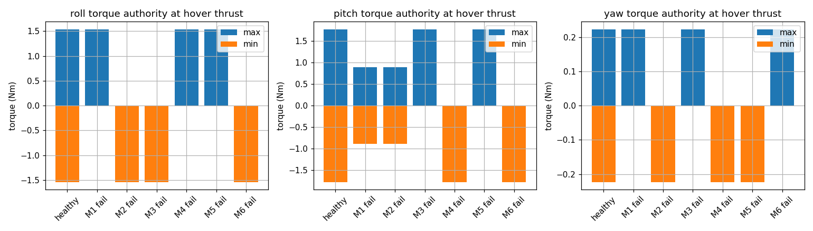

## 3. Results: control re-allocation (fault known)

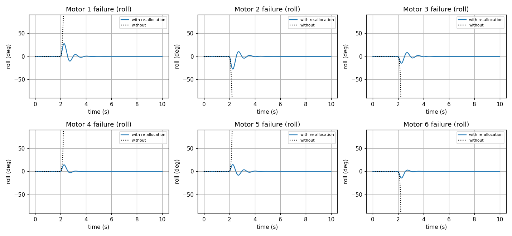

| Failed motor | Without re-allocation | With re-allocation: peak roll / pitch | Min altitude | Settle time | Final yaw |
|---|---|---|---|---|---|
| M1, M2 | flips after 0.22 s | 27° / 3° | 9.93 m | 1.6 s | ±15° |
| M3 – M6 | flips after 0.22 s | 15° / 24° | 9.93 m | 1.3 – 1.7 s | ±15° |

- With the normal mixer, the vehicle flips 0.22 s after any motor failure. With re-allocation, every case returns to level hover.
- The allocator also turns off the **opposite motor** (for example, M2 when M1 fails). The remaining four settle at 86 rad/s (2.32 N each, 75% of their maximum thrust). During the transient they peak at 97 rad/s, just under the 99.6 rad/s limit.
- **Yaw is given up.** Only one direction of yaw torque is left, so the heading settles about 15° off. Roll, pitch and altitude are kept, which is the intended trade-off.
- Peak roll for M1 matches the thesis (27.4° here, about 28° there).

Motor 1 failure in detail. The bottom row shows each motor's thrust against its limit, and the total thrust against the weight. The dotted line is the same failure without re-allocation.

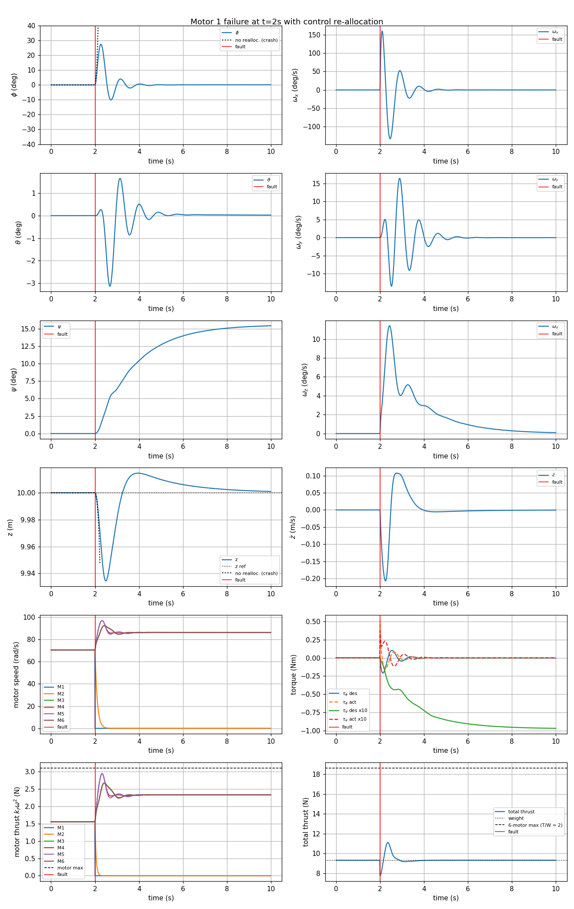

## 4. ADRC: fault treated as a disturbance

### Implementation

Each axis (roll, pitch, yaw, altitude) has its own loop:

- **Tracking differentiator** (Han's `fhan`): turns the reference into a smooth profile.
- **Linear extended state observer (LESO):** estimates the angle z₁, the rate z₂ and the total disturbance z₃. Its gains are 3ω_o, 3ω_o² and ω_o³.
- **Control law:** u = (k_p(v₁ − z₁) + k_d(v₂ − z₂) − z₃) / b₀, with k_p = ω_c², k_d = 2ω_c, and b₀ = 1/J (1/m for altitude).

Choices specific to the hexacopter:

- **Fault-blind:** the moments always go through the **healthy mixer**. The controller gets no fault information. This is stricter than the paper, which switches gains and set-points once a severe fault happens. Here nothing is ever switched.
- **Gains:** roll and pitch use ω_c = 14 and ω_o = 50 rad/s; yaw and altitude use 2 and 10 rad/s. Lower attitude gains react too slowly, and the vehicle tips over before the observer catches the fault.
- **Motor lag:** the LESO is fed the commanded torque passed through the known 0.1 s motor model. Without this, the observer treats the motor lag as a disturbance and the loop goes unstable.
- **CG offset:** the CG is moved a distance r from the centre of the motors, in direction θ within the rotor plane. Mass and inertia stay the same, so the thrust now acts with a lever arm r about the CG (τ = −r × T). The offset is ramped in over 0–2 s so the vehicle starts from a trimmed hover, and then motor 1 fails at t = 5 s. Neither controller is told about the CG.

Four setups are compared: PID with the fault unknown, PID + re-allocation with the fault known, **ADRC with the fault unknown** (the proposed method), and ADRC + re-allocation as a reference.

Code: [python/hexa_adrc.py](python/hexa_adrc.py). Results: [python/results_adrc/](python/results_adrc/).

### Key result 1: ADRC survives the fault without knowing about it

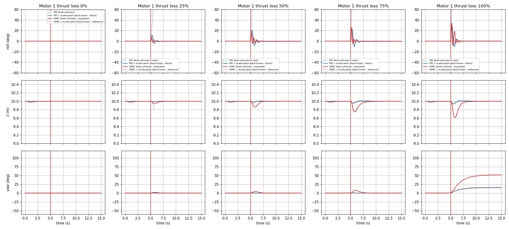

Peak tilt after a motor 1 fault, by thrust loss:

| Thrust loss of M1 | PID, fault unknown | PID + re-alloc, fault known | **ADRC, fault unknown** | ADRC + re-alloc |
|---|---|---|---|---|
| 25% | crash | 11.4° | **7.2°** | 3.4° |
| 50% | crash | 20.8° | **15.8°** | 5.7° |
| 75% | crash | 23.0° | **25.9°** | 6.9° |
| 100% | crash | 27.4° | **33.9°** | 11.5° |

- Fault-blind PID crashes even at 25% thrust loss. **Fault-blind ADRC recovers at every level.**
- Up to 50% loss, it even does better than re-allocation, which knows the fault.
- At total loss, ADRC dips 38 cm (re-allocation: 7 cm), settles in 2.2 s (re-allocation: 1.6 s) and its heading drifts 52° (re-allocation: 16°).
- ADRC also ends up turning off M2, the configuration re-allocation chooses on purpose. ADRC gets there by itself, through the observer.

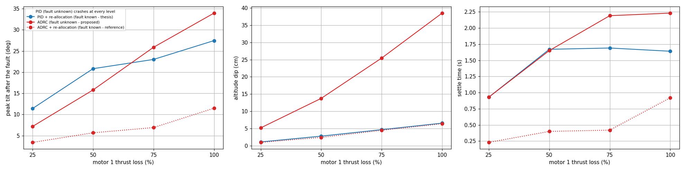

The same comparison as curves. Fault-blind ADRC's tilt and settle time cross the thesis method's between 50% and 75% loss, but its altitude dip is larger at every level: the altitude loop is slow and has to estimate the lost thrust.

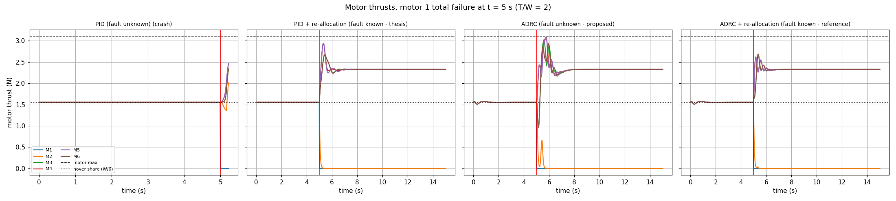

Motor thrusts at total loss of M1. Fault-blind ADRC briefly drives M3–M6 right up to the 3.11 N limit, while M2 drops, comes back once, then switches off. With the fault known, they peak at 2.7–2.95 N.

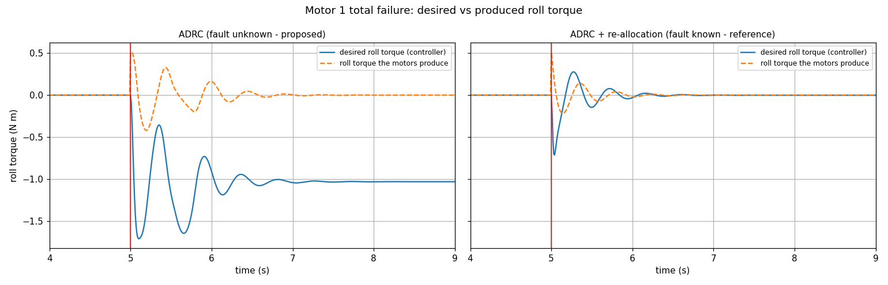

This is what not knowing the fault costs. Fault-blind ADRC settles asking for −1.03 N·m of roll torque while the motors produce zero net torque: the healthy mixer sends part of every request to the dead motor, and the LESO's z₃ grows until it cancels exactly that. With the fault known, the requested and produced torque match, which is why the transient is smaller.

### Key result 2: CG location matters

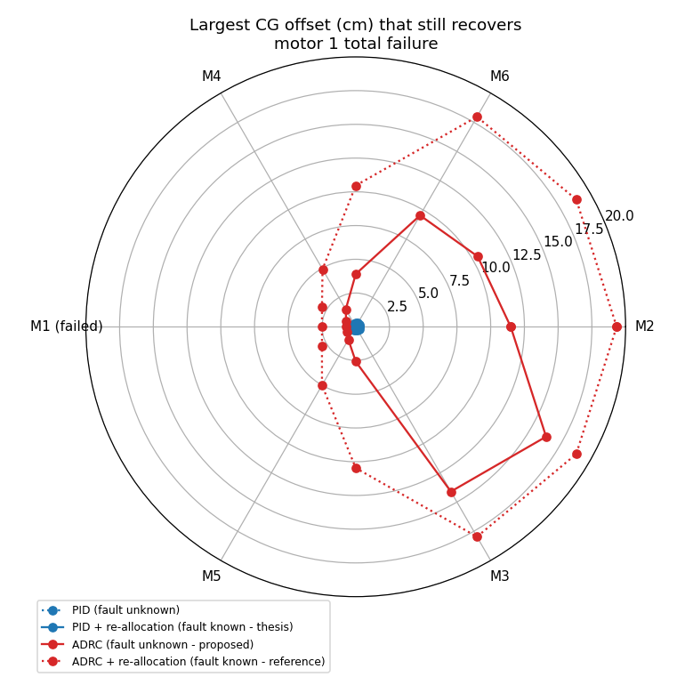

Largest CG offset that still recovers after motor 1 fails:

| CG direction | PID + re-alloc, fault known | **ADRC, fault unknown** | ADRC + re-alloc |
|---|---|---|---|
| Away from the failed motor (toward M2, M3, M6) | 0.3 cm | **9.5–16.3 cm** | 18.0–19.3 cm |
| Sideways (90°, 270°) | 0.3 cm | **2.6–3.9 cm** | 10.5 cm |
| Toward M4 or M5 (next to the failed motor) | 0.3 cm | **1.1–1.5 cm** | 4.9–5.0 cm |
| Toward the failed motor (M1 side) | 0.1–0.2 cm | **0.7–0.8 cm** | 2.5–2.9 cm |

Fault-blind PID scores 0 in every direction: it crashes from the motor failure alone, even with the CG centred.

- **ADRC tolerates a CG offset of several centimetres, PID only millimetres.** PID's rate integrator is clamped at about 0.007 N·m, so it cannot build up the steady torque an offset needs.
- **Direction matters a lot.** Fault-blind ADRC handles up to 16 cm away from the failed motor, but under 1 cm toward it.
- **Toward the failed motor, knowing the fault helps** (0.7 cm → 2.5 cm). The thrust margin is thin (T/W = 2), so the effort the healthy mixer wastes on the dead motor matters there.
- With the CG 4 cm off, fault-blind ADRC survives the motor failure in 5 of the 12 directions, all on the side away from M1.

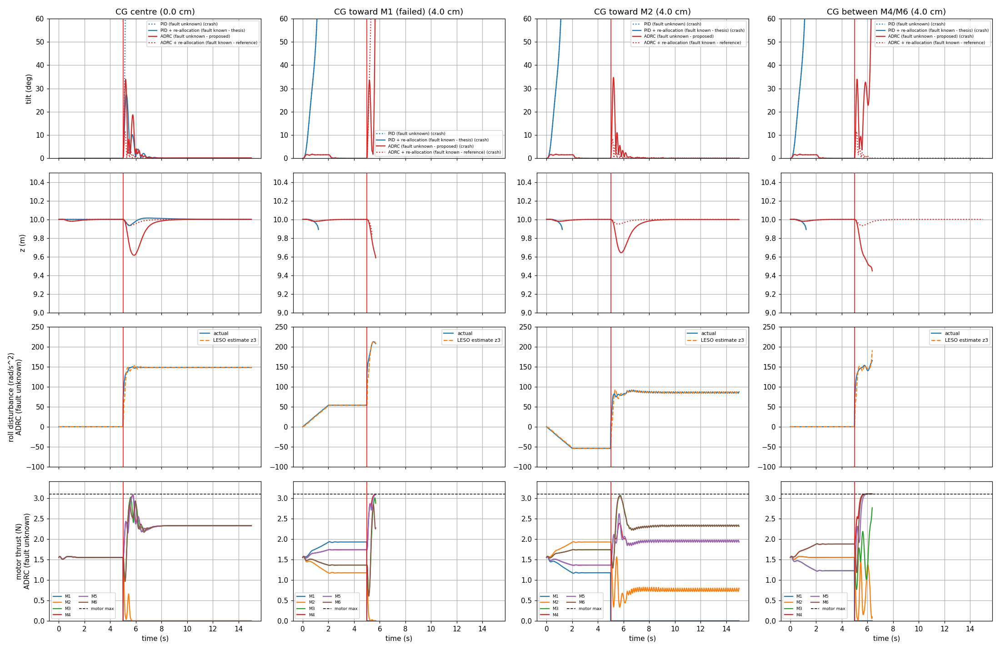

This plot uses a 4 cm CG offset. The third row shows how ADRC works: the LESO estimate z₃ follows the actual roll disturbance, first the CG offset ramping in (about ±55 rad/s²), then the jump when motor 1 fails. It catches the jump within about 0.2 s, without being told what changed. The bottom row shows why the crashes happen: toward M1 and between M4/M6, the disturbance is still estimated correctly, but two or three motors are pinned at the 3.11 N limit and cannot produce the torque.

### PID vs ADRC as the CG offset grows

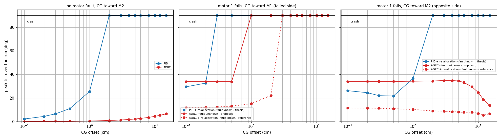

Peak tilt over the whole run as the CG offset grows from 1 mm to 15 cm (90° = crash):

| Case | PID | **ADRC, fault unknown** | ADRC + re-alloc |
|---|---|---|---|
| No motor fault | leans 2° at 1 mm, 25° at 1 cm; crashes from 2 cm | **stays level (only up to 6.6° while the offset ramps in, then back to 0°) up to 15 cm** | – |
| M1 fails, CG toward M1 | crashes from 0.3 cm | **survives up to 0.5 cm** | survives up to 2 cm |
| M1 fails, CG toward M2 | no crash up to 1 cm, but stays tilted (10° at 0.5 cm, 25° at 1 cm); crashes from 2 cm | **no crash up to 15 cm (fully level again up to about 11 cm)** | survives up to 15 cm |

- **Without any fault, PID cannot even hold a CG offset.** It settles at a steady lean that grows with the offset, because its integrator cannot build up the needed torque, and it crashes at 2 cm. ADRC levels out completely at every offset tested.
- **With the CG toward M2,** the offset partly cancels the fault's torque, so ADRC's peak tilt falls from 34° to 14° as the offset grows to 15 cm.

### Trade-off: sensor noise

| Attitude noise | PID + re-alloc: motor jitter | ADRC, fault unknown: motor jitter | Survives total M1 loss? |
|---|---|---|---|
| 0.3° | 0.06 rad/s | 0.39 rad/s | both |
| 1.0° | 0.19 rad/s | 1.41 rad/s | **PID yes, ADRC no** |

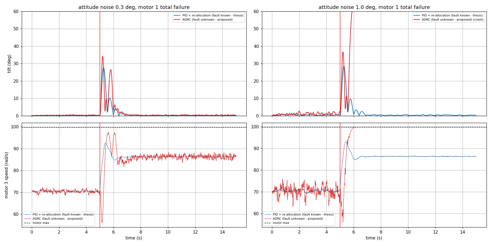

ADRC passes about 7× more noise to the motors because of its fast observer. With T/W = 2 there is too little thrust margin left for that, and with 1° of noise it crashes after the fault.

### Full plots for every simulation

Every ADRC-study run also has its own 12-panel plot in [python/results_adrc/cases/](python/results_adrc/cases/): 20 fault-sweep runs (e.g. `M1_loss_50pct__ADRC_fault_unknown.png`) and 52 CG runs with motor 1 failing (e.g. `CG_4cm_toward_M1__PID_realloc_fault_known.png`, `CG_4cm_between_M1-M4__ADRC_realloc_fault_known.png`). Each shows:

- roll and pitch, yaw, tilt, and the three body rates
- altitude and climb rate
- each motor's speed and thrust against its limit, and total thrust against weight and the 6-motor maximum
- desired vs produced roll and pitch torque, and desired vs produced thrust
- the LESO disturbance estimate against the actual roll disturbance (ADRC runs)

The title gives the outcome (recovered with settle time, or crash time), peak tilt, altitude dip and peak motor speed. The re-allocation cases in [python/results/](python/results/) have the same kind of full plot.

## 5. ROS 2 implementation

- **Nodes:** `plant_node` (dynamics, fault, CG offset, RViz scene) and `ftc_node` (controller and allocation) run in lockstep over `/state` and `/motor_cmd`. Both import the same Python modules as the offline study.
- **Launch arguments:**
  - `controller:=pid|adrc`
  - `use_ftc:=true|false` (re-allocation on or off)
  - `fault_motor`, `fault_eta`
  - `cg_cm`, `cg_angle`
- **Validation:** the ROS runs reproduce the Python results, with the same crash outcomes and attitude traces within 0.03°.

Results: [ros2_ws/results_ros/](ros2_ws/results_ros/) (re-allocation) and [ros2_ws/results_adrc_ros/](ros2_ws/results_adrc_ros/) (ADRC).

ROS 2 run of fault-blind ADRC with the CG 4 cm toward M2, and motor 1 failing at t = 5 s:

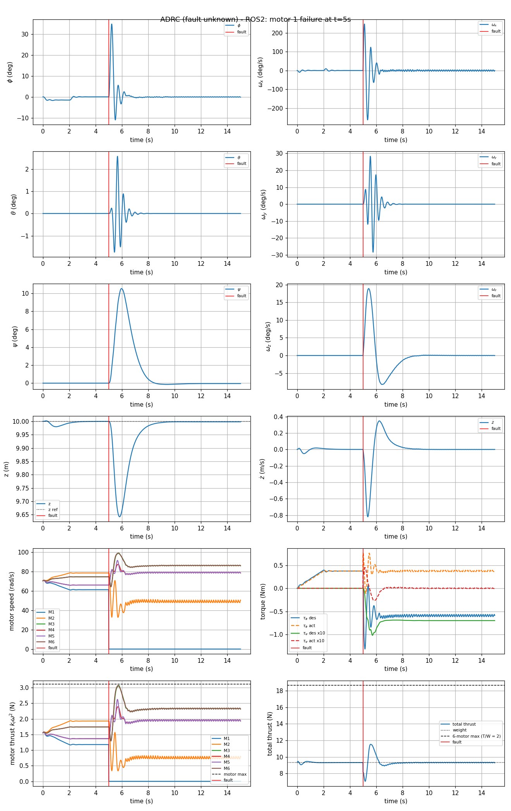

## 6. Conclusions

- With the fault known, re-allocation recovers from any single motor failure in under 1.7 s, with tilt under 28° and altitude loss under 7 cm. The heading drifts about 15°.
- **ADRC removes the need to know which motor failed.** It recovers from 25–100% thrust loss of a motor, and it holds an unknown CG offset level, which PID cannot even do without a fault.
- With the fault unknown, ADRC tolerates a CG offset of up to 16 cm away from the failed motor, but under 1 cm toward it. With thrust-to-weight 2 the margin there is thin, and knowing the fault raises it to 2.5 cm.
- **Limitations:**
  - Re-allocation assumes the fault is detected instantly.
  - ADRC's high gains make it sensitive to sensor noise: with T/W = 2 it does not survive 1° of attitude noise plus a total motor failure.
